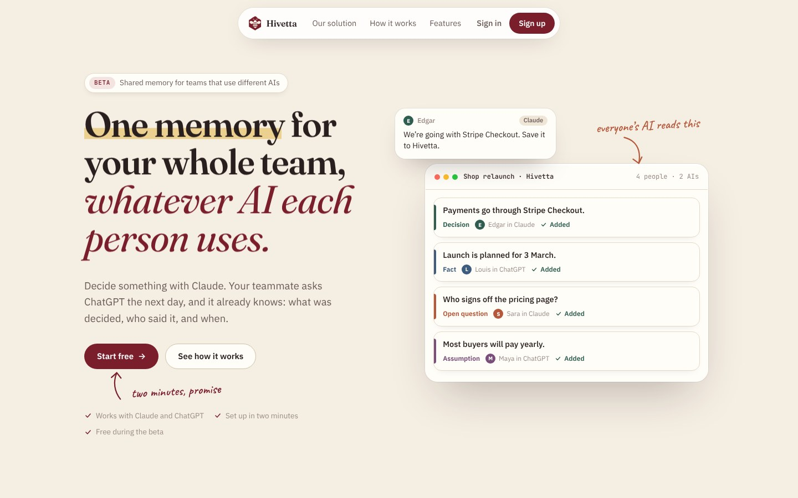
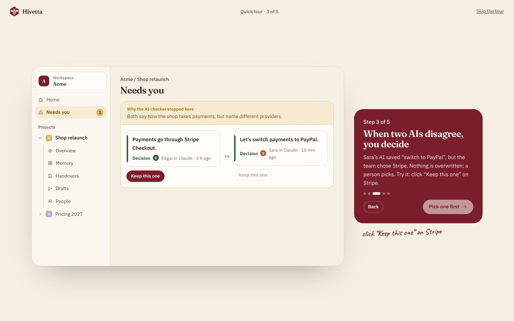

# Hivetta

A shared memory for teams whose members use different AI assistants. You decide something with Claude; your teammate asks ChatGPT the next day, and it already knows what was decided, who said it and when.

[](https://hivetta.com)

**Live:** [hivetta.com](https://hivetta.com) (private beta: the landing page and a [2-minute tour with example data](https://hivetta.com/welcome) are public) · **Demo video:** [docs/media/hivetta-demo.mp4](docs/media/hivetta-demo.mp4)

## Why I built it

In team projects everyone now works with their own AI assistant, so decisions end up scattered across private chats. Nobody knows what was agreed in someone else's conversation, and two assistants can happily give opposite answers. I wanted one memory that every assistant can write to and read from, without asking anyone to switch tools.

Early prototype co-built with Louis Bettelli; I designed and built the current product: the database and its security rules, the MCP server with OAuth, the AI conflict checker, handovers, draft branches and the web app. I now run it as a private beta with a few friends.

## What it does

- **Save from any assistant:** say "save what we decided to Hivetta". The assistant sends structured memories (decisions, facts, assumptions, open questions) through an MCP server.
- **Ask from any assistant:** "how do we take payments?" returns the relevant memories with who saved them, from which AI, and when.
- **An AI checks every new memory:** duplicates are merged automatically; when two memories contradict each other, a person picks one. Nothing is silently overwritten.
- **Handovers:** when you finish your part, your AI writes a state-of-play note that the next person's AI reads before starting.
- **Drafts, like git branches:** save to a draft space, then merge it into the team memory once it's ready.



## How it works

Each person connects Hivetta's hosted MCP server to their own assistant (Claude, ChatGPT or any client with connectors), signing in through OAuth. Memories are validated, tagged with their provenance and stored in Postgres. A database trigger calls a Supabase Edge Function for each new memory: Claude Haiku compares it with its nearest neighbours and returns `new`, `duplicate` or `conflict`.

Decisions that shaped the design:
- **The rules live in the database, not in app code.** Provenance, "nothing is ever deleted" and per-project access are enforced by Postgres constraints, triggers and row-level security, so no code path can bypass them.
- **Assistants can read and propose, never approve.** Resolving a conflict or removing someone needs a signed-in session in the web app, so a confused AI can't rewrite the team's memory.
- **Contradictions go to a human.** The AI checker only merges exact duplicates; it never picks a winner on its own.

**Stack:** TypeScript, Next.js 16, Model Context Protocol (MCP), Supabase (Postgres, pgvector, Auth as OAuth 2.1 server, Edge Functions), Claude Haiku, Zod, Vercel, Vitest.

## Run it

```bash
corepack pnpm install
corepack pnpm db:local:start && corepack pnpm db:local:env   # local Supabase (needs Docker)
corepack pnpm --filter @memory/web dev
```

Full setup (Supabase OAuth, deployment, connecting Claude and ChatGPT) is in [docs/SETUP.md](docs/SETUP.md) and [docs/CONNECTORS.md](docs/CONNECTORS.md).

## Limitations

- **Private beta:** a handful of users so far, no load testing.
- Supabase tokens are not bound to the MCP server's URL yet, so the Supabase project must stay dedicated to this app.
- Vector search scans each project exactly instead of using the index; fine up to tens of thousands of memories per project.
